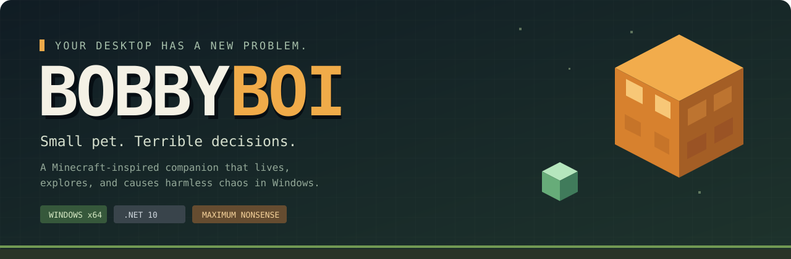
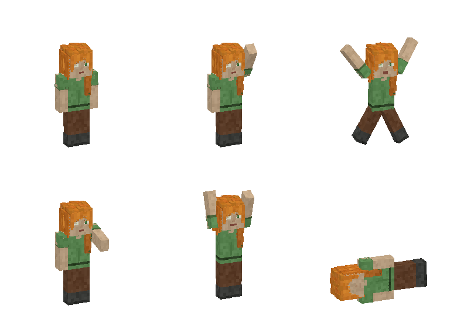
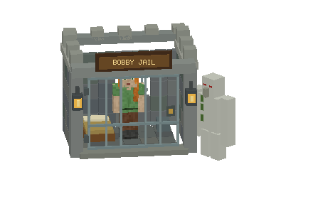
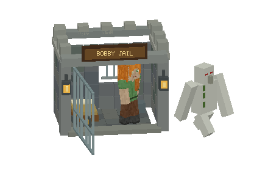
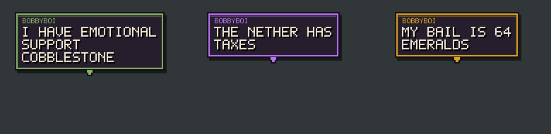
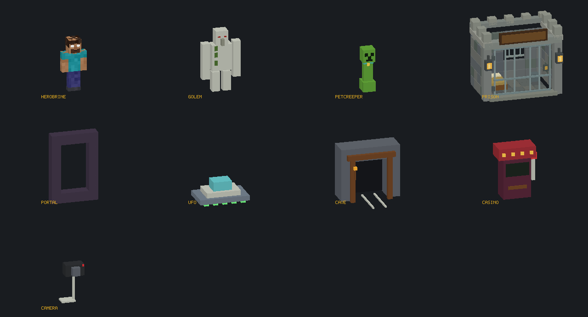
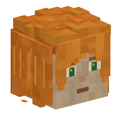

<div align="center">



[](https://github.com/AlbertinoTheCoder/BobbyBoi/releases/latest)
[](https://github.com/AlbertinoTheCoder/BobbyBoi/actions/workflows/build.yml)
[](LICENSE)


**A tiny Minecraft-inspired desktop companion with a very large list of bad ideas.**

He fishes. He mines. He adopts a creeper. He gets arrested for illegal dirt trading.

[**Get BobbyBoi**](https://github.com/AlbertinoTheCoder/BobbyBoi/releases/latest) · [How to play](#how-to-play) · [The chaos](#a-small-world-with-a-lot-going-on) · [Build it](#build-from-source) · [Report a bug](https://github.com/AlbertinoTheCoder/BobbyBoi/issues/new/choose)

</div>

---

## Meet your least productive employee

I made BobbyBoi to live on top of your Windows desktop as a transparent, animated voxel pet. Pick him up, throw him between monitors, give him snacks, or leave him to make questionable life choices.

His Alex-inspired character, mobs, and expansion props have editable Blender source. The app renders them locally, makes its own sounds, and runs without a network connection.



> **“My tax bracket is dirt.”** — BobbyBoi, probably avoiding work

## Get started

1. Open the [latest release](https://github.com/AlbertinoTheCoder/BobbyBoi/releases/latest).
2. Download **BobbyBoi-Windows-x64.zip** and extract it.
3. Run **BobbyBoi.exe**. Right-click the pet or his tray icon to open the menu.

**Windows 10/11, x64.** The download includes .NET. No installer, Python, Blender, paid service, or administrator account is needed to run it.

## How to play

| You do this | BobbyBoi does this |
|:--|:--|
| Click / double-click | Waves / jumps |
| Drag, then flick and release | Gets thrown across the desktop |
| Right-click | Opens gifts, activities, settings and world controls |
| Give food or a shiny item | Eats, celebrates and holds the gift |
| Temporarily interrupt an activity | Resumes its existing stage afterward |
| Open **World actions** | Goes fishing, builds, explores, climbs, or starts a boss fight |
| Open **Crime and bad decisions** | Makes one of ten new terrible decisions |
| Choose **Restart BobbyBoi** | Restarts and applies a staged local build if available |

Outside clicks, Escape and choosing an action close the menu and its submenus. Moving the pointer away does not. Double-click the tray icon to bring him back if you hid him.

## A small world with a lot going on

| Everyday nonsense | Extremely questionable hobbies |
|:--|:--|
| Fishing with weighted catches and visible rod/line | Get arrested by an Iron Golem |
| A dirt house, storage and visits | Lose fictional emeralds at the casino |
| A persistent wolf companion | Build and enter a Nether portal |
| Treasure, inventory and achievements | Spot Herobrine and immediately regret it |
| Multi-monitor movement and throwing | Survive a local, app-only earthquake |
| Climbing ordinary window edges | Install a clearly fake update stuck at 99% |
| Temporary clones | Adopt a harmless confetti creeper |
| Zombies, creepers, damage and respawning | Record an offline BobbyTube video |
| A tiny Ender Dragon fight | Get abducted by a tiny UFO |
| Meme expeditions | Go cave mining and return with loot or problems |

Events connect: casino debt can lead to jail, portal trips can introduce a creeper, and UFO survivors can become conspiracy content creators. One major activity owns movement at a time.

<table>
<tr>
<td width="50%"><p align="center"><b>Serving time for suspicious fishing.</b></p></td>
<td width="50%"><p align="center"><b>Time served. Bad ideas pending.</b></p></td>
</tr>
</table>

### He also brings things back

Meme expeditions take him beyond the desktop edge and return with an original TXT, meme PNG, or intentionally terrible drawing. By default, the actual file opens in **Notepad or Paint**, and he carries that new application window in before letting go.

Generated files stay in **BobbyBoi Memes** on your Desktop. BobbyBoi does not overwrite existing files or move pre-existing application windows. Notepad should be set to open files in a **new window**, rather than reusing tabs, for the full delivery animation.

### Pixel personality, with sound

- **124 shuffled contextual speech lines**, plus expansion dialogue.
- Minecraft-inspired speech panels with bitmap lettering, colored accents and type-on animation.
- **55 original synthesized SFX**, with overlapping explosion, fishing, damage and death sounds.
- Cached sprites, small redraw regions, and an optional performance mode.



## Your desktop stays yours

Effects, prisons, portals, quakes and explosions belong to BobbyBoi's overlay world. The fake update is a small labeled panel; BobbyTube is offline. Nothing gets uploaded.

There are a few intentional real-desktop interactions: meme trips create files and open new Paint/Notepad windows, climbing reads window bounds, and an **optional cursor prank is disabled by default**. Its explicit setting enables at most 1.2 seconds of desktop-only pointer movement, with Escape, quick mouse movement and Ctrl+Alt+Backspace cancellation.

Settings control volume/mute, activities, natural mob spawning, sightings, pranks, companions, performance, topmost behavior, and optional startup. Preferences and inventory live in `%LOCALAPPDATA%\BobbyBoi\settings.json`.

## Build from source

Install the **.NET 10 SDK** on Windows, then:

```powershell
git clone https://github.com/AlbertinoTheCoder/BobbyBoi.git
cd BobbyBoi
.\build.bat
```

The build publishes a standalone x64 EXE, runs regression checks, and updates the root executable when it is not running. Otherwise, use **Restart BobbyBoi** to apply the staged build.

For a quick development build:

```powershell
dotnet build -c Release
dotnet run --project src/BobbyBoi -c Release
```

There are no third-party runtime package dependencies. Blender is only needed to edit/re-export models.

```text
BobbyBoi.slnx   Windows solution
src/BobbyBoi/   App, renderer and activity systems
assets/         Original Blender projects and exported meshes
tests/          Regression and native-overlay checks
docs/           Technical notes, previews and release notes
```

<details>
<summary><b>Inside the little disaster</b></summary>

- **C# / .NET 10 / Windows Forms** — per-pixel-alpha native overlays.
- **Software voxel rendering** — Blender JSON exports, depth-tested props/mobs and bounded sprite caches.
- **Shared activity director** — priorities, eligibility, cooldowns, interruption/resume and cleanup.
- **Original PCM audio** — cached samples and a small eight-voice Windows mixer.
- **Blender workshop** — `assets/BobbyBoi.blend`, `BobbyBoiMobs.blend` and `BobbyBoiChaos.blend`.



See [technical notes and verification commands](docs/TECHNICAL.md) and [contributing](.github/CONTRIBUTING.md).

</details>

## License

My original code and assets are available under the [PolyForm Noncommercial License 1.0.0](LICENSE). Use, modification and redistribution are allowed for permitted noncommercial purposes. Commercial use requires separate permission from me. See the full license and [notices](docs/NOTICE.md).

## What still needs work

This is an evolving desktop toy. The core event sequences work; many alternate gag endings are simplified. Mixed-DPI layouts, monitor hotplug and exclusive fullscreen games still need broader testing. Rendering benchmarks are not a promise of a particular desktop FPS.

Found something weird? [Open an issue](https://github.com/AlbertinoTheCoder/BobbyBoi/issues/new/choose) with what happened, your Windows version and steps to reproduce it.

---

<div align="center">


**Created and maintained by [AlbertinoTheCoder](https://github.com/AlbertinoTheCoder). Powered by dirt and bad judgment.**

<sub>Unofficial fan project. Not affiliated with Mojang or Microsoft. Minecraft is a trademark of its respective owners.</sub>
</div>
